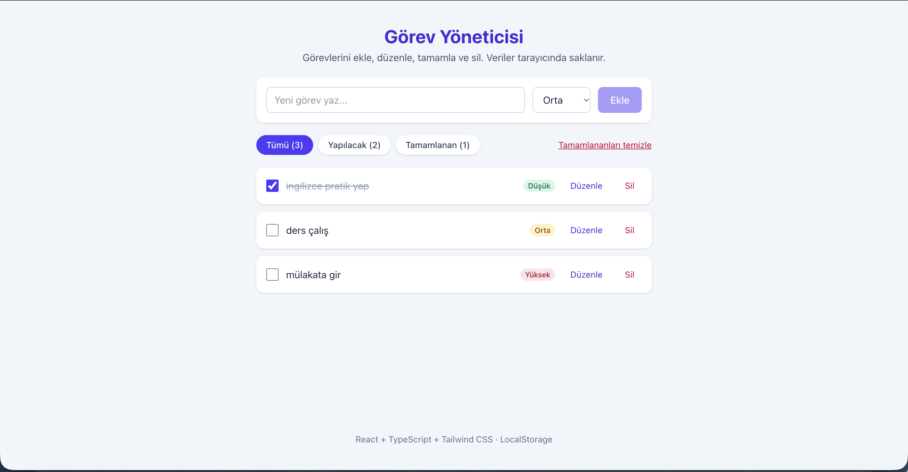

# Görev Yöneticisi

React, TypeScript ve Tailwind CSS ile geliştirilmiş, görevleri tarayıcının LocalStorage'ında saklayan basit bir görev (Todo) uygulaması. TNC Group / Software Persona "Web Geliştirme; Javascript" eğitimi proje ödevidir.

## Özellikler (CRUD)

- **Ekle:** Başlık ve öncelik girerek yeni görev ekleme
- **Listele:** Görevleri listeleme, Tümü / Yapılacak / Tamamlanan filtresi
- **Güncelle:** Görevi tamamlandı olarak işaretleme, başlığı ve önceliği düzenleme
- **Sil:** Onaylı tekli silme ve tamamlananları toplu temizleme

## Kullanılan teknolojiler

React 19 · TypeScript · Vite · Tailwind CSS 4 · LocalStorage

## Klasör yapısı

```
src/
├── components/   TodoForm, TodoList, TodoItem, FilterBar
├── pages/        HomePage
├── interfaces/   todo.ts
├── hooks/        useTodos.ts
└── utils/        storage.ts
```

## Kurulum

```bash
npm install
npm run dev      # geliştirme sunucusu
npm run build    # üretim derlemesi (dist/)
```

## Ekran görüntüsü



## Yayın

- GitHub: https://github.com/sonmez9/Web-Gelistirme-Javascript
- Netlify: https://web-gelistirme-javascript.netlify.app
